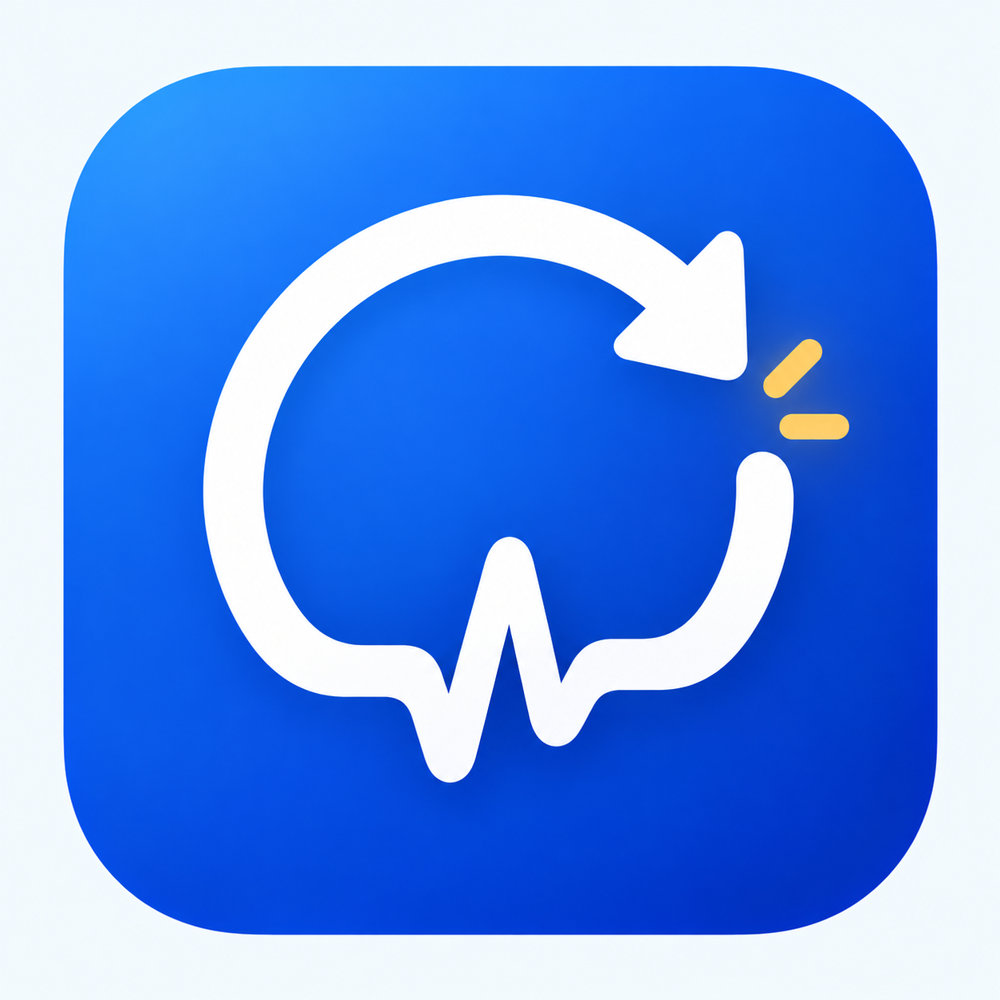
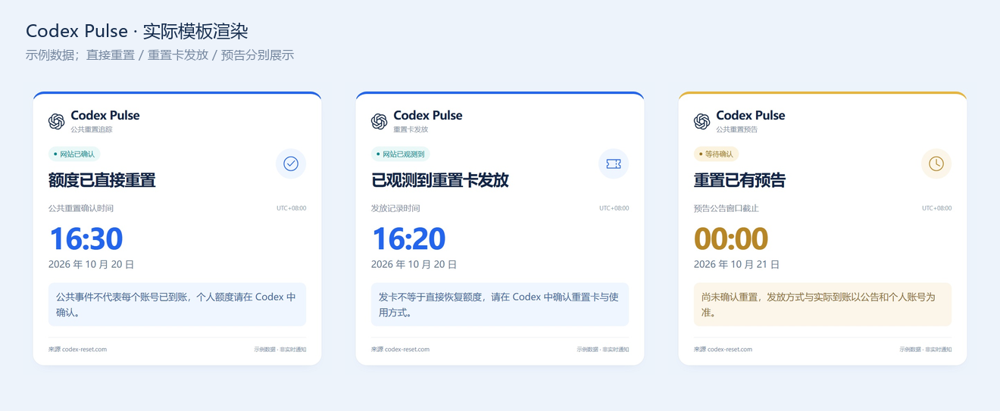

<p align="center"></p>

<h1 align="center">Codex Pulse · 重置脉搏</h1>

<p align="center">把公共额度重置、重置卡发放与重置预告，变成一眼读懂的通知卡片。</p>

<p align="center">AstrBot 插件 · v1.0.1 · AGPL-3.0</p>



## 能做什么

- **三类事件清楚区分**：额度直接重置、重置卡发放、尚未落地的预告分别通知、分别去重。
- **图片优先，文字兜底**：查询展示完整信息，群通知保持精简；渲染超时或不可用时自动返回文字。
- **通知按需开启**：三类独立开关，配合群黑白名单；关闭的类型仍同步基线，重新开启不补发已见旧事件。
- **管理员测试卡片**：一条指令检查三类卡片的实际收图效果，示例有醒目标注，不请求上游、不修改通知进度。
- **来源随你选择**：可关闭图片后附带的 Tibo 推特和 codex-reset.com 链接；卡片内仍保留来源署名。

## 安装

在 AstrBot 插件管理中选择**从链接安装**，填写：

```text
https://github.com/Eason4869/astrbot_plugin_codex_pulse
```

也可以从本仓库 Releases 下载 ZIP，通过 AstrBot 的**从文件安装**上传。安装后启用 **Codex Pulse｜重置脉搏**。

使用 AstrBot 已配置的 **HTML 文转图服务**，不需要安装其他图片插件；`aiohttp` 由 AstrBot 提供。若图片无法生成，先检查 AstrBot 的文转图配置；文字回退仍可用。

## 第一次使用

1. 在插件配置中选择白名单，填写需要接收通知的群号，保存并重载。
2. 普通成员发送 `/codex` 查看完整状态。
3. AstrBot 管理员在目标群发送 `/codex 测试`，验证三类示例卡片。
4. 按需要关闭某类通知，或关闭“随卡片发送源链接”。

管理员指 **AstrBot 配置的管理员账号**，群管理员身份本身不获得管理权限。测试指令只回复当前群，不会向其他群广播。

## 指令

| 指令 | 功能 | 权限 |
| --- | --- | --- |
| `/codex` 或 `/codex 状态` | 上次直接重置、概率、预告、发卡记录和本群通知状态 | 所有人 |
| `/codex 上次` | 上次直接重置时间与最近发卡记录 | 所有人 |
| `/codex 预测` | 网站概率、有效预告、公告窗口和历史间隔参考 | 所有人 |
| `/codex 订阅` / `/codex 取消` | 在当前名单模式下启用或关闭本群通知 | AstrBot 管理员 |
| `/codex 测试` | 依次发送三种示例卡片 | AstrBot 管理员，群聊 |
| `/codex 测试 直接重置` | 只测试直接重置卡片 | AstrBot 管理员，群聊 |
| `/codex 测试 发卡` | 只测试重置卡发放卡片 | AstrBot 管理员，群聊 |
| `/codex 测试 预告` | 只测试预告卡片 | AstrBot 管理员，群聊 |
| `/codex 帮助` | 查看用法 | 所有人 |

保留 `/codex重置` 别名，以及 `status / last / forecast / subscribe / unsubscribe / help / test` 英文参数。测试类型支持 `all / direct / ticket / watch` 和 `reset / banked`。指令前缀遵循 AstrBot 唤醒配置。

测试使用本地示例数据，强制尝试图片输出，不受自动通知、分类开关或文字模式影响；渲染不可用时返回明确标注的示例文字。测试卡片仍遵循来源链接开关。

## 配置

| 设置 | 默认 | 说明 |
| --- | --- | --- |
| 启用自动通知 `enabled` | 开 | 总开关，关闭不影响查询和管理员测试 |
| 通知：额度直接重置 `notify_direct_reset` | 开 | 控制已确认的公共直接重置 |
| 通知：重置卡发放 `notify_banked_reset` | 开 | 控制发卡公告、发放中、已观测可用 |
| 通知：重置预告 `notify_reset_watch` | 开 | 控制有效的强信号预告 |
| 随卡片发送源链接 `send_source_links` | 开 | 图片后附带数据源与原公告链接 |
| 查询输出 `query_output` | `image` | `image` / `text` |
| 自动通知输出 `notification_output` | `image` | `image` / `text` |
| 群名单模式 `group_mode` | `whitelist` | 白名单或黑名单 |
| 群号 / 群会话 `group_ids` | 空 | 白名单为空时不主动通知任何群 |
| 轮询间隔 `poll_interval` | 120 秒 | 最少 60 秒，无通知目标时不请求接口 |
| 时区 `utc_offset` | `8` | 固定 UTC 偏移，支持小数，不自动切换夏令时 |
| HTTP 代理 `proxy` | 空 | 留空遵循代理环境变量 |

配置保存后重载。分类开关只控制自动通知；总开关开启且存在通知目标时，关闭的类型继续通过轮询同步基线，重新开启不补发关闭期间已见的事件。

群列表可填写纯群号（匹配各实例的同号群），或 `bot1:GroupMessage:123456789` 形式的完整会话。OneBot 自动发现群地址；其他适配器收到群消息后记录地址，也可直接配置完整会话。白名单只通知列表中的群；黑名单通知列表以外已识别的群。订阅与取消直接修改同一份配置，并保留当前名单模式。

## 如何理解通知

| 卡片 | 表示什么 |
| --- | --- |
| **额度已直接重置** | 网站确认公共额度重置；个人到账仍应在 Codex 中核实 |
| **重置卡发放已公告** | 公告已出现，不能当作个人重置卡已到账 |
| **重置卡正在发放** | 网站标记为发放进行中 |
| **已观测到重置卡发放** | 网站观测到重置卡可用；发卡不等于额度直接恢复 |
| **重置已有预告** | 等待确认，窗口边界不代表个人到账时间 |

重置卡读取独立时间线，不改变直接重置时间或历史间隔；未知状态不主动推送。新安装先建立历史基线，不补发旧重置和旧发卡；当前仍有效、尚未通知过的预告会通知一次。离线恢复只处理最新记录，不逐条补发历史。发送成功后保存进度，失败时重试；发送完成与保存之间异常退出仍可能重复一次。

数据来自 [codex-reset.com](https://codex-reset.com/)，无需 OpenAI 账号或 API Key，无法读取个人额度。预告评分与 24/48 小时概率分别展示；历史推算不是倒计时。数据超过 30 分钟未更新时不用于对应通知，两个接口独立工作；查询使用旧缓存时醒目标注。

## 图片与兼容性

模板、OpenAI 图标随插件提供，不加载外部字体、背景或图标。渲染环境需要中文字体，建议思源黑体或 Noto Sans CJK。HTML 和展示内容会发送到 AstrBot 配置的渲染服务，是否本地运行取决于该服务配置。

渲染超时、异常或返回无效图片地址时，最多等待 12 秒后回退完整文字；故障后 60 秒内直接使用文字，再自动尝试恢复。来源链接开关只控制**成功出图后的附加链接**，不删除文字模式或文字回退中的来源。

主动群通知要求适配器支持 AstrBot 主动发送接口，例如 OneBot；QQ 官方 API 不支持此主动接口。实际图片接收效果可由管理员执行 `/codex 测试` 验证。

### 从旧插件迁移

先停用旧的 `astrbot_plugin_codex_reset`，再安装本插件并迁移原群名单、时区和代理设置，避免两个插件同时通知。新插件使用独立配置与 KV 命名空间，不自动读取旧通知进度；首次启动建立新基线，当前有效预告仍可能通知一次。

## 来源与许可

基于 [Koishi0425/astrbot_plugin_codex_reset](https://github.com/Koishi0425/astrbot_plugin_codex_reset)（原署名 Glmg）继续开发，保留上游历史与 AGPL-3.0 许可。由 Eason4869 维护，与 OpenAI 无隶属关系。

OpenAI 图标来自 Lobe Icons，依照 MIT License 使用；本项目的脉搏循环 Logo 为独立设计。详见 [NOTICE](NOTICE.md)。更新见 [CHANGELOG](CHANGELOG.md)，开发与验证见 [开发说明](docs/DEVELOPMENT.md)。
